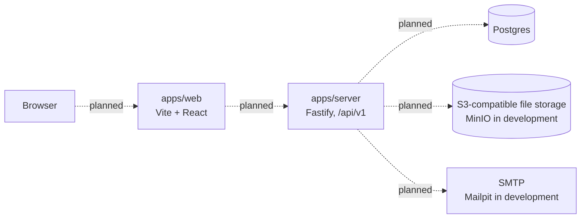

# Toki

Internal team chat for one company: single-tenant, self-hosted, built in phases. Phase 1 is core chat on the web.

> Status: the repository holds the workflow files and the specs of the first ten tickets (TOKI-001 to TOKI-008, TOKI-095, TOKI-096). The workspace and its eight empty projects are in place (TOKI-001); no application code is on `main` yet. Everything marked `(planned)` below is described by a spec in [`docs/specs/`](docs/specs/) and arrives with the ticket named next to it.

## 1. Overview

This repository owns:

- The intents and specs of the product work: [`docs/intents/`](docs/intents/), [`docs/specs/`](docs/specs/).
- The working agreements for people and for Claude: [`CLAUDE.md`](CLAUDE.md), [`.claude/settings.json`](.claude/settings.json), [`docs/definition-of-done.md`](docs/definition-of-done.md).
- The automation that gives a merged spec its ticket: [`.github/workflows/spec-ticket.yml`](.github/workflows/spec-ticket.yml).
- The server, the web app and the shared packages: empty projects in `apps/` and `packages/` for now; their code arrives with the later tickets.

Work moves in one direction: intent -> spec -> ticket -> plan -> pull request. A spec merged into `main` gets a ticket on the tracker; a spec with an open question or concern gets a blocked ticket.

## 2. Architecture



None of these boxes runs yet; `apps/web` and `apps/server` are empty projects.

- The web app calls the server under `/api/v1`; in development a proxy in the web app forwards those calls to the local server.
- The server keeps its data in Postgres, stores files in S3-compatible storage (MinIO in development) and sends sign-in mail over SMTP (Mailpit catches it in development).
- Each company runs its own copy on one VPS.
- Shared code lives in packages (`shared`, `client-core`, `tokens`, `i18n`, `platform`, `ui-web`). Lint rules keep `client-core`, `shared`, `i18n` and `tokens` free of browser APIs, so a later native app can reuse them.

## 3. Tech Stack

`(planned)` unless marked as in place; the spec of each ticket is the source.

- Node 22, pnpm workspace, TypeScript (TOKI-001, in place)
- ESLint, Prettier and three package boundary rules (TOKI-002, in place)
- Docker Compose with Postgres, MinIO and Mailpit for development (TOKI-003)
- Fastify (TOKI-004), Drizzle migrations on Postgres (TOKI-005)
- Vite, React, TanStack Router, TanStack Query (TOKI-006)
- GitHub Actions (TOKI-007)
- Vitest (minimal setup TOKI-004, full harness TOKI-008), Playwright (TOKI-008)

## 4. Prerequisites

- Git and Bash, to clone the repository and run the one existing test.
- The GitHub CLI (`gh`) with write access to this repository, to open pull requests.
- Node 22. `.nvmrc` pins it; with nvm, run `nvm install` in the repository root (it installs that version if needed and switches to it); with another version manager, switch to Node 22. Under another Node major version every pnpm command that touches the project stops with "This project requires Node.js 22.x".
- pnpm 12.21.0 through Corepack, which ships with Node 22. Run `corepack enable` once per Node installation; the version comes from `packageManager` in `package.json`. If `corepack enable` reports a permission error, skip it and put `corepack` in front of each command (`corepack pnpm install`).
- Docker `(planned, TOKI-003)`.

## 5. Quick Start

1. Clone the repository.

   ```bash
   git clone https://github.com/thanhtruong-agilityio/toki.git
   cd toki
   ```

2. Read [`CLAUDE.md`](CLAUDE.md) before the first change. With Claude Code, start work on a ticket with `/cl-core:ticket <ticket>`.

3. Run the existing test to confirm the checkout works. It ends with `all cases passed`.

   ```bash
   bash .github/scripts/spec-ready.test.sh
   ```

4. Install the dependencies and type-check all projects, under Node 22.

   ```bash
   nvm install
   corepack enable
   pnpm install
   pnpm typecheck
   ```

5. Run the lint and format checks. All three exit 0 on a clean checkout.

   ```bash
   pnpm lint
   pnpm lint:boundaries
   pnpm format:check
   ```

Running the apps arrives with TOKI-003 (services), TOKI-004 (server) and TOKI-006 (web). Commands: TBD.

## 6. Project Structure

```text
.
├─ CLAUDE.md                     working agreements for Claude sessions
├─ .claude/settings.json         project permissions for Claude Code
├─ .github/
│  ├─ pull_request_template.md   Ticket, What, Why, How tested, Screenshots, Risk
│  ├─ scripts/                   spec check, its test, and the ticket script
│  └─ workflows/spec-ticket.yml  gives each merged spec its ticket
├─ docs/
│  ├─ intents/                   one file per raw requirement
│  ├─ specs/                     one design per intent, named <date>-<slug>-design.md
│  ├─ plans/                     implementation plan per ticket (planned, TOKI-095)
│  ├─ definition-of-done.md      when a ticket is done
│  └─ ticket-config.yml          tracker, statuses, labels, thresholds
├─ apps/                         server and web (empty projects)
├─ packages/                     shared, client-core, tokens, i18n, platform, ui-web (empty projects)
├─ eslint.config.js              lint style and the three package boundary rules
├─ tools/
│  ├─ lint-rules/                the three local ESLint rules the boundaries use
│  └─ lint-fixtures/             one fixture per boundary rule, and check.mjs that runs them
├─ e2e/                          Playwright end-to-end tests (planned, TOKI-008)
└─ infra/                        development Compose file and scripts (planned, TOKI-003)
```

## 7. Testing

One test exists today, for the script that decides whether a spec has open points:

```bash
bash .github/scripts/spec-ready.test.sh
```

Lint and format have four commands, run from the repository root:

```bash
pnpm lint             # ESLint over the whole repository; a warning fails too
pnpm lint:boundaries  # proves that each boundary rule still fires on its fixture
pnpm format:check     # Prettier in check mode
pnpm format           # rewrites badly formatted files
```

`eslint.config.js` holds three boundary rules as lint errors:

- `client-core`, `shared`, `i18n` and `tokens` use only the globals of an allow list and import nothing that needs the DOM, so React Native can reuse them. To use a new global there, add it to the allow list in `eslint.config.js` and to the copy in `tools/lint-fixtures/check.mjs`. A type is not a global: the types that go with the allowed globals (`RequestInit`, `MessageEvent`) pass, and only the DOM types `Window`, `Document`, `Element` and every `HTML...` or `SVG...` type are an error.
- A file in `apps/server/src` imports a server module (`src/modules/<name>/`) only through its `index.ts`, unless the file is inside that same module.
- `ui-web` does not use the notification, storage, service worker or audio APIs directly; it goes through `platform`.

The rules hold for every source file under `src/` of those folders (`.ts`, `.tsx`, `.mts`, `.cts`, `.js`, `.jsx`, `.mjs`, `.cjs`); test files (`*.test.*`) are outside the first and the third rule. An `eslint-disable` comment has no effect in those paths and is itself a failure; a boundary changes only in `eslint.config.js`. Lint cannot check file picking in `ui-web`, a raw SQL query against another module's table, a DOM type outside the named ones, or a renamed copy of `window`; those rely on review.

Lint runs on the TypeScript 6 API, because `typescript-eslint` cannot load TypeScript 7 yet: in the root `package.json` the name `typescript` is an alias of `@typescript/typescript6`, and `@typescript/native` is TypeScript 7, which still provides `tsc` for `pnpm typecheck`. An editor that uses the workspace TypeScript version therefore runs 6.0 for its language service; `pnpm typecheck` is the reference.

The test harness for the apps (Vitest against a real Postgres, Playwright) and the CI checks are `(planned, TOKI-008 and TOKI-007)`. [`docs/definition-of-done.md`](docs/definition-of-done.md) requires a test for every change and green CI.

## 8. Deployment

Nothing is deployed yet; the production image and the deploy on merge are `(planned, TOKI-084 and TOKI-085)`.

- Merging a pull request is done by a person on GitHub. Agents never merge and never force-push.
- Commits and pushes go to a ticket branch, never to `main`.
- Every deploy and every branch deletion needs approval first.

## 9. Links

- Board: https://github.com/thanhtruong-agilityio/toki/issues
- Design doc: the [Toki Blueprint](https://claude.ai/code/artifact/e6b79d7f-ff70-41b2-99d6-d2cb61c33b35), kept outside this repository.
- Specs: [`docs/specs/`](docs/specs/)
- Runbook: TBD
- Changelog: TBD
- API reference: TBD
